# Cloud-Based Event Management and Registration System

**Course:** 23CSC205 – Cloud Computing Laboratory (Mini-Project)  
**Department:** CSE (Cyber Security), Madanapalle Institute of Technology & Science  
**Student:** Rupa Sree Sompalli · **Roll No.:** 24691A37D7

> This file is generated together with `Project_Report.docx`; the Word file is the version for submission.

## 1. Problem Statement

College events are usually announced on notice boards and registrations are collected on paper or in scattered spreadsheets. Organisers cannot see how many seats are left, students register twice or miss out when an event fills up, entry on the day is checked by hand, and there is no record of who changed what.

## 2. Objectives

1. Provide a web portal where users can browse, search and register for events.
2. Enforce seat capacity, prevent duplicate registrations and run a fair waiting list for full events.
3. Issue a unique e-ticket with a QR code and let staff check attendees in at the venue.
4. Give administrators full control of events and users, and a dashboard to monitor the service.
5. Protect the application against common web attacks.
6. Build the application so that it can be deployed to a cloud platform without code changes.

## 3. Technology Stack

| Layer | Technology |
|---|---|
| Language | Python 3.12 |
| Web framework | Flask 3 with Jinja2 templates |
| Application server | Waitress (production WSGI server, same on Windows and Linux) |
| Database | SQLite in WAL mode (file-based relational database) |
| Security | Werkzeug password hashing, signed session cookies, CSRF tokens, Content-Security-Policy |
| QR codes | segno (pure-Python QR generator, rendered as inline SVG) |
| Front end | HTML5, CSS design system with light and dark themes, inline SVG icons, no external libraries |
| Testing | pytest with the Flask test client (43 automated test cases) |
| Deployment | Dockerfile, Procfile and Render blueprint (render.yaml) |

## 4. Architecture

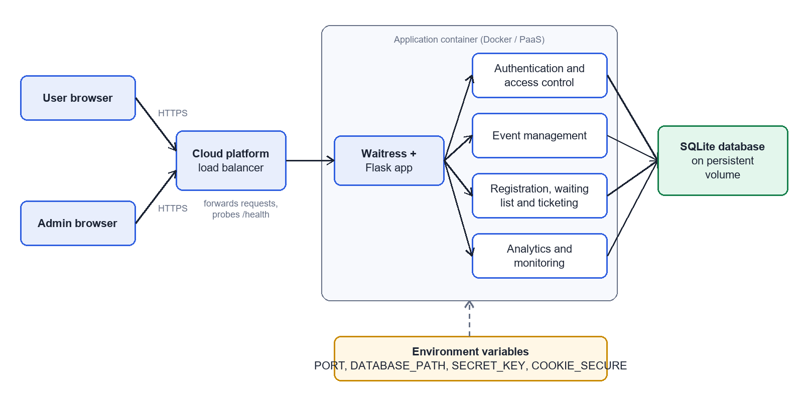

*Figure 1. System architecture*

**Request flow for a registration:** the user logs in, opens an event and presses Register. The application opens a write transaction, checks the event date, duplicate status and seats left, and inserts the registration as confirmed, or as waitlisted when the event is full. It writes an activity-log entry, commits, and shows the e-ticket or the waiting-list position.

**Waiting-list promotion:** when a confirmed attendee cancels, when the administrator raises the capacity, or when a user account is deleted, the freed seats are given automatically to the people who have waited longest, inside the same transaction.

### 4.1 Database design

| Table | Main columns | Purpose |
|---|---|---|
| users | id (PK), name, email (unique), password_hash, role, created_at | Accounts and roles (user / admin) |
| events | id (PK), title, description, category, venue, event_date, event_time, capacity, created_by (FK users) | Events published by administrators |
| registrations | id (PK), user_id (FK), event_id (FK), ticket_code (unique), status (confirmed / waitlisted / cancelled), registered_at, checked_in_at; unique (user_id, event_id) | One booking per user per event, with check-in time |
| activity_log | id (PK), user_id, action, details, ip, created_at | Audit trail used for monitoring and for the login lockout |

One user makes many registrations; one event has many registrations; deleting an event or a user removes their registrations (cascade). Indexes cover the event date, the registration status per event and the log action. A built-in migration upgrades a version 1 database (no waiting list) without losing data.

## 5. Modules

### 5.1 Authentication and access control

- Sign-up with validation of name, email format, password strength (8+ characters with a letter and a number), matching confirmation and unique email.
- Passwords are stored only as salted hashes.
- Two roles, user and admin. Admin pages return 403 for normal users and redirect guests to login.
- Change-email and change-password pages for every user, each confirmed with the current password; the admin is warned at login while the sample password is still in use.
- Login lockout: after 5 wrong passwords for one account from one IP address, further logins are blocked for 5 minutes (HTTP 429).

### 5.2 Event management

- Administrator can create, read, update and delete events, from the dashboard or from Admin tools on each event page.
- Server-side validation of title, description, category, venue, date, time and capacity.
- Capacity cannot be reduced below the number of seats already booked; raising it promotes people from the waiting list.
- Public listing with keyword search, category filter, upcoming / past / all filter and pagination (9 events per page).

### 5.3 Registration, waiting list and ticketing

- One-click registration for logged-in users; a unique ticket code such as EVT-9F3A1C2B is issued.
- When an event is full the user joins a waiting list and sees their position; freed seats go to the longest-waiting person automatically.
- Duplicate registrations and registrations for past events are rejected.
- The seat check and the insert run inside one database transaction, so two simultaneous requests cannot both take the last seat.
- E-ticket page with a QR code and a print button. The QR code holds the admin-only check-in link for that ticket.
- Staff check-in: an administrator scans the QR code or types the ticket code, sees the attendee, and admits them once only.

### 5.4 Admin analytics and monitoring

- Dashboard with events, users, confirmed bookings, waiting-list size, cancellations, check-ins and percentage of seats filled.
- Occupancy bar and waiting-list count for each event, and bookings by category.
- Attendee list per event with check-in status and CSV export.
- User management: promote to admin, demote, or delete a user (an admin cannot change their own account, so one admin always remains).
- Activity log of logins, failed and blocked logins, bookings, waiting-list moves, check-ins and admin changes, with a filter and pagination.
- One-click database backup download (consistent online snapshot).

### 5.5 User interface and experience

- A small design system: colour, spacing, radius and shadow tokens defined once in CSS and used by every page.
- Each event category has its own colour, used on cards, date badges, banners and charts, so events are easy to scan.
- Event cards show the date at a glance, how soon the event is, and a seat bar that turns amber when nearly full and red when full.
- Light and dark themes: the site follows the device setting automatically.
- Responsive layout from 375 px phones to wide desktops, with a collapsible menu on small screens.
- Clear feedback: notifications slide in and success messages fade away; confirmation is asked before cancelling or deleting.
- Accessible: keyboard focus is always visible, a skip-to-content link, labelled icons and form fields, and reduced motion when the device asks for it.
- Fast and safe: no external fonts, libraries or inline scripts, so it works offline and fits the strict Content-Security-Policy.

## 6. Security Measures

| Threat | Defence in this project |
|---|---|
| Password theft from the database | Only salted password hashes are stored |
| Password guessing (brute force) | Lockout after 5 failures per account and IP address; every failure is logged |
| Weak passwords | Minimum 8 characters with a letter and a number; default admin password is flagged |
| SQL injection | Every query uses bound parameters; user input is never joined into SQL text |
| Cross-site scripting (XSS) | Templates escape all output; a Content-Security-Policy forbids inline and third-party scripts |
| Cross-site request forgery (CSRF) | A secret token in every form, checked on every POST; SameSite session cookie |
| Session theft and fixation | HttpOnly cookie, Secure flag on HTTPS, new session at login, 8-hour expiry |
| Clickjacking | X-Frame-Options: DENY and frame-ancestors 'none' |
| Broken access control | Role check on every admin route; users can open or cancel only their own bookings |
| Open redirect at login | Only same-site paths are accepted as the return address |
| Spreadsheet formula injection | Exported CSV cells that start with = + - @ are neutralised |
| Race condition on the last seat | Seat check and booking happen in one locked transaction |
| Cached private pages on shared PCs | Cache-Control: no-store on every logged-in page |
| Forged client address behind a proxy | X-Forwarded headers are discarded unless TRUST_PROXY is enabled |

## 7. Cloud Concepts Demonstrated

| Concept | Where it appears in the project |
|---|---|
| Software as a Service (SaaS) | Users need only a browser; nothing is installed on their device |
| Platform as a Service (PaaS) | Procfile and render.yaml describe the service for Render / Railway |
| Containerisation | Dockerfile packages the app and its dependencies into a portable image that runs as a non-root user |
| Configuration through environment | HOST, PORT, DATABASE_PATH, SECRET_KEY, COOKIE_SECURE and TRUST_PROXY are read from environment variables |
| Persistent storage | Database file sits on a mounted volume, separate from the disposable container |
| Database service | Relational schema with constraints, indexes, transactions and a schema migration |
| Authentication and access control | Hashed passwords, sessions, role-based authorisation, login lockout |
| Load balancing and health checks | /health probe for the platform, container HEALTHCHECK, proxy-aware client address |
| Monitoring and audit | Activity log with filter, dashboard statistics |
| Backup and recovery | Admin database snapshot download; restore by replacing the file |
| REST API | /api/events returns JSON so other services can consume event data |
| Scalability | Stateless app (session in a signed cookie) served by a multi-threaded server |

**Limitation:** SQLite suits one application instance. To scale out to several servers, the database would be moved to a managed service such as PostgreSQL.

## 8. Test Cases

All cases are automated in tests/test_app.py and run with the command python -m pytest -v. Result: 43 passed. The pages were also checked by hand in a browser at desktop and phone width.

| ID | Area | Test case | Expected result | Status |
|---|---|---|---|---|
| TC01 | Events | Open home page | Seeded events are listed | Pass |
| TC02 | Auth | Sign up with valid details, then log in | Account created, login succeeds | Pass |
| TC03 | Auth | Sign up with bad email, short and mismatched password | Error messages shown, HTTP 400 | Pass |
| TC04 | Auth | Sign up with an existing email | "already exists" error | Pass |
| TC05 | Auth | Log in with wrong password | "Invalid email or password", HTTP 401 | Pass |
| TC06 | Access control | Guest and normal user open every admin page and action | Guest redirected to login, user gets 403 | Pass |
| TC07 | Security | Inspect stored password | Only a hash is stored | Pass |
| TC08 | Events | Search "hackathon", filter by Sports | Only matching events shown | Pass |
| TC09 | Events | Admin creates, edits and deletes an event | Each change is visible; deleted event returns 404 | Pass |
| TC10 | Events | Submit event with empty title, negative capacity, bad date | Validation errors, HTTP 400 | Pass |
| TC11 | Events | Reduce capacity below booked seats | Rejected with message | Pass |
| TC12 | Registration | Register, register again, open ticket | Confirmed with ticket code; duplicate rejected; ticket opens | Pass |
| TC13 | Registration | Register without logging in | Redirected to login | Pass |
| TC14 | Waiting list | Register for a full event | Added to waiting list at position 1 | Pass |
| TC15 | Registration | Cancel, then re-register | Seat count drops, re-booking succeeds | Pass |
| TC16 | Access control | Cancel or view another user's booking | HTTP 403 | Pass |
| TC17 | Admin | Dashboard, CSV export, activity log, backup | All load; backup is a valid SQLite file | Pass |
| TC18 | Cloud | Call /health and /api/events | status ok; JSON list of upcoming events only | Pass |
| TC19 | Security | POST without CSRF token | HTTP 400 | Pass |
| TC20 | Security | Enter 5 wrong passwords, then the correct one | Sixth attempt blocked with HTTP 429; other accounts unaffected | Pass |
| TC21 | Security | 4 wrong passwords, correct login, 4 more wrong, correct login | Both correct logins succeed (count resets) | Pass |
| TC22 | Auth | Change password with wrong current, mismatched, then valid values | Errors shown; then old password fails and new one works | Pass |
| TC23 | Security | Admin logs in with the sample password | Warning to change the default password | Pass |
| TC24 | Security | Inspect session cookie | HttpOnly and SameSite=Lax set; Secure set when enabled | Pass |
| TC25 | Security | Sign up with weak passwords | Rejected: needs 8+ characters, a letter and a number | Pass |
| TC26 | Security | Log in with a return address pointing to another site | Redirect stays on this site | Pass |
| TC27 | Security | Inspect response headers and page source | CSP, nosniff, frame denial present; nothing inline; private pages not cached | Pass |
| TC28 | Security | Export CSV for a user whose name is a spreadsheet formula | Formula is neutralised with a leading quote | Pass |
| TC29 | Security | Sign up with a script tag as the name | Name is shown as text, not run | Pass |
| TC30 | Waiting list | Confirmed attendee cancels a full event | First waiting person is confirmed automatically and logged | Pass |
| TC31 | Waiting list | Admin raises capacity of a full event | Waiting person is given the new seat | Pass |
| TC32 | Waiting list | View position, then leave the waiting list | Position 1 shown; "You left the waiting list" | Pass |
| TC33 | Registration | Register for an event that is over | Rejected; event appears only under Past | Pass |
| TC34 | Ticketing | Open a valid and a cancelled ticket | QR code only on the valid ticket | Pass |
| TC35 | Check-in | Admin checks in a ticket twice; looks up an unknown code | First succeeds, second refused, unknown code reported | Pass |
| TC36 | Check-in | Check in a cancelled ticket | Refused | Pass |
| TC37 | Admin | Promote, demote and delete users; try to delete own account | Role changes apply; own account is protected | Pass |
| TC38 | Waiting list | Delete a user who held a seat in a full event | Waiting person is confirmed | Pass |
| TC39 | Events | Open pages 1, 2, 999 and an invalid page number | 9 per page; out-of-range pages are clamped | Pass |
| TC40 | Errors | Open a missing page; GET a POST-only address | Friendly 404 and 405 pages | Pass |
| TC41 | Database | Start the app on a version 1 database | Table is migrated, existing rows kept, no re-seeding | Pass |
| TC42 | Auth | Change email with wrong password, invalid and taken addresses, then a valid one | Errors shown; then old email fails and the new one logs in | Pass |
| TC43 | Admin | Open an event page as guest, student and admin | Edit, Attendees and Delete buttons shown only to the admin | Pass |

## 9. Screenshots

*Figure 2. Home page – hero with search and category filters*

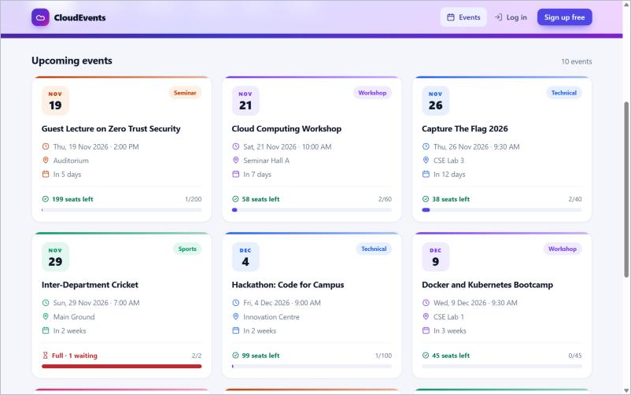

*Figure 3. Home page – event cards with date, venue and live seat availability*

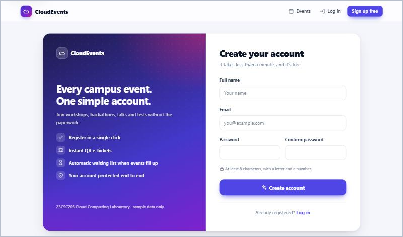

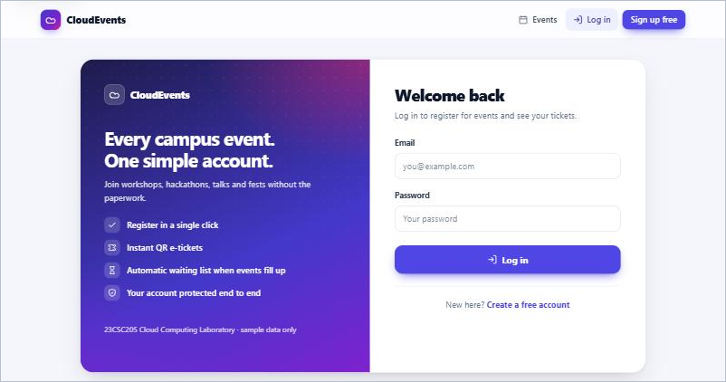

*Figure 4. Sign-up and login pages*

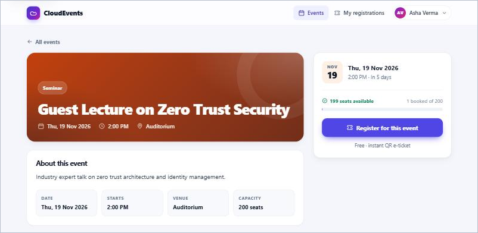

*Figure 5. Event detail page with the Register button*

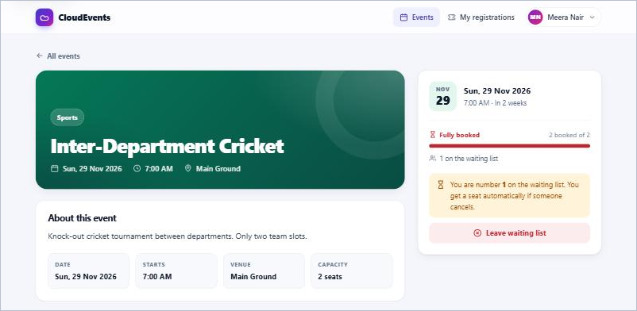

*Figure 6. Full event – the user's position on the waiting list*

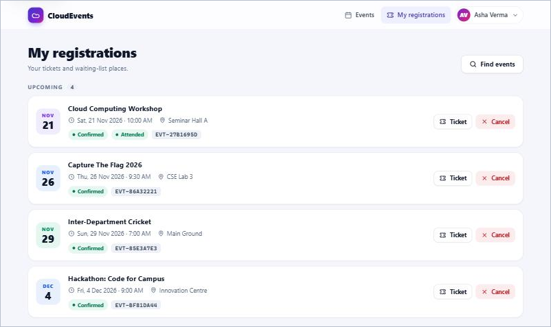

*Figure 7. My registrations*

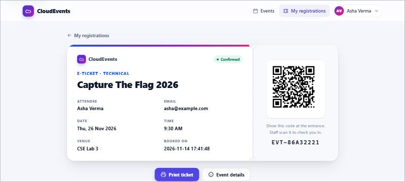

*Figure 8. E-ticket with QR code*

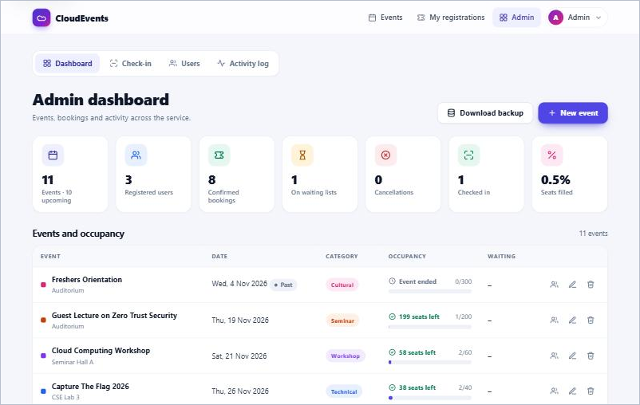

*Figure 9. Admin dashboard – summary tiles and event occupancy*

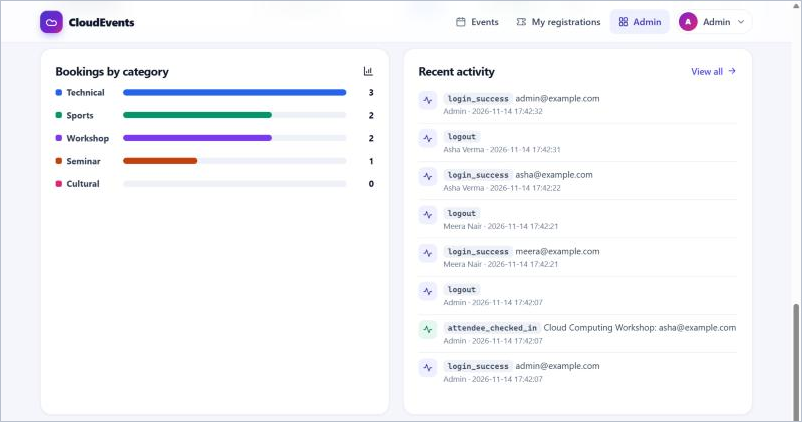

*Figure 10. Admin dashboard – bookings by category and recent activity*

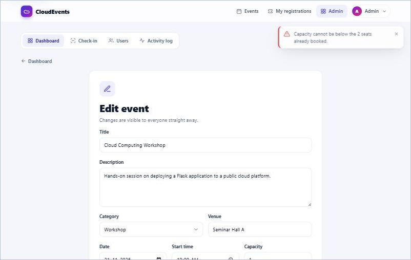

*Figure 11. Edit event form showing a validation message*

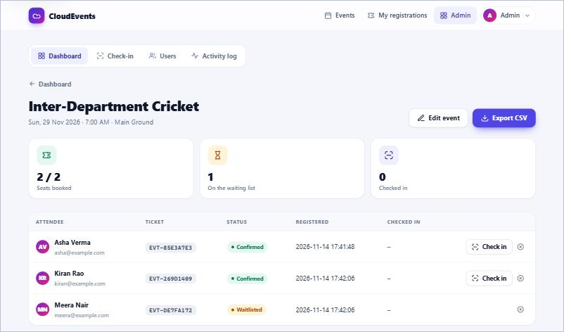

*Figure 12. Attendee list with confirmed and waitlisted users, check-in buttons and CSV export*

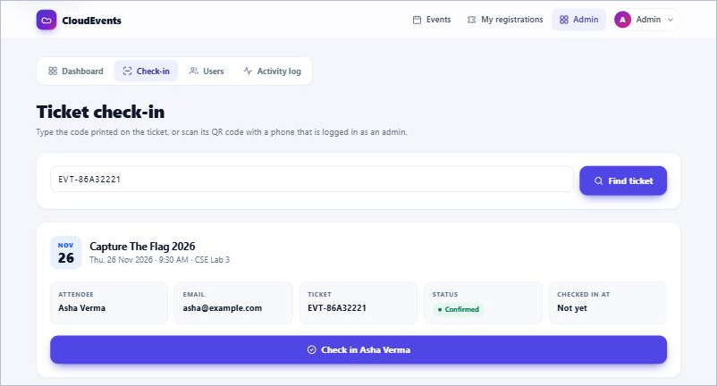

*Figure 13. Ticket check-in page for staff*

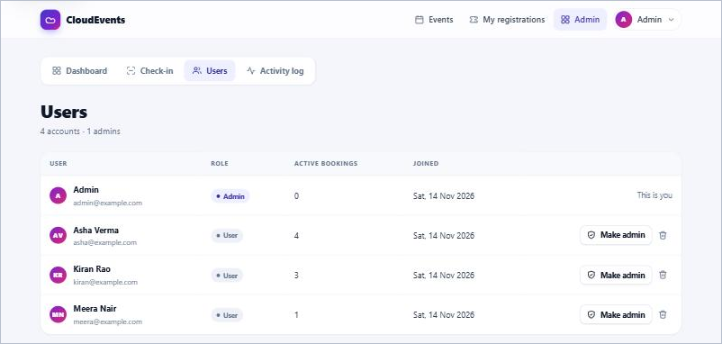

*Figure 14. User management*

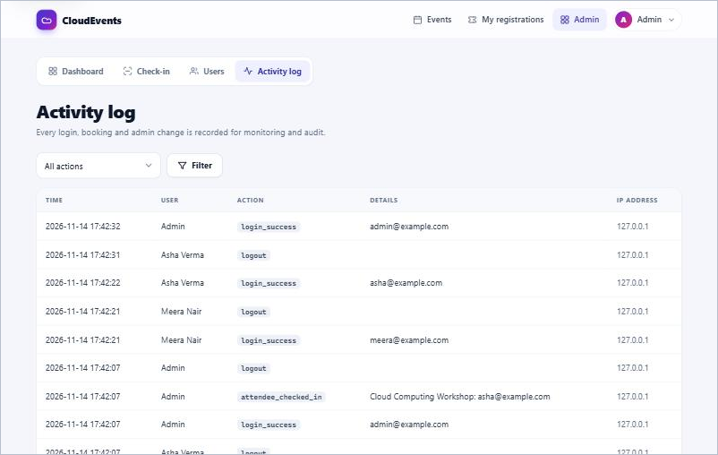

*Figure 15. Activity log*

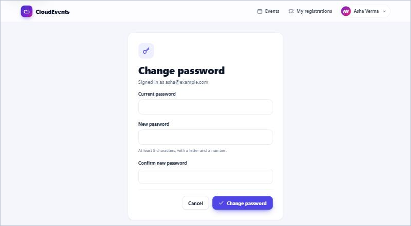

*Figure 16. Change password page*

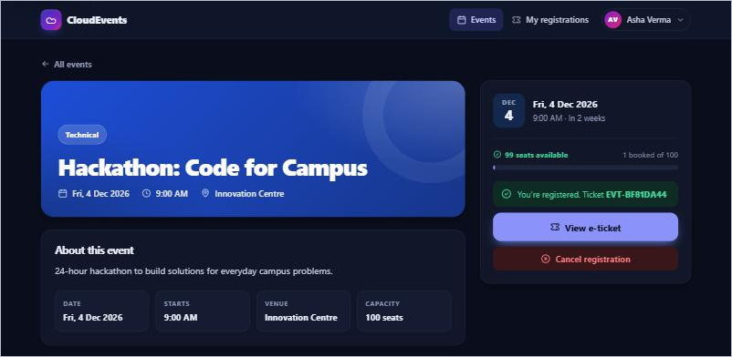

*Figure 17. Dark theme – applied automatically when the device uses dark mode*

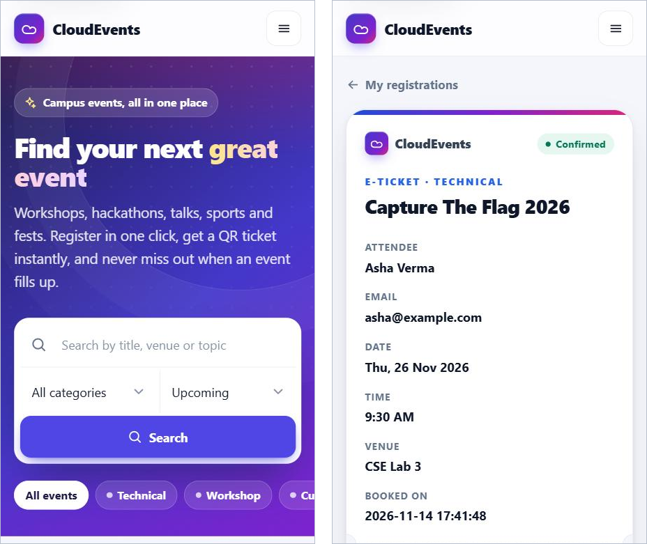

*Figure 18. Phone layout (375 px wide): home page and e-ticket*

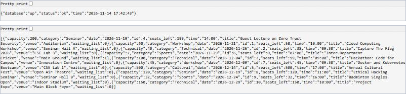

*Figure 19. Output of /health (top) and /api/events (bottom)*

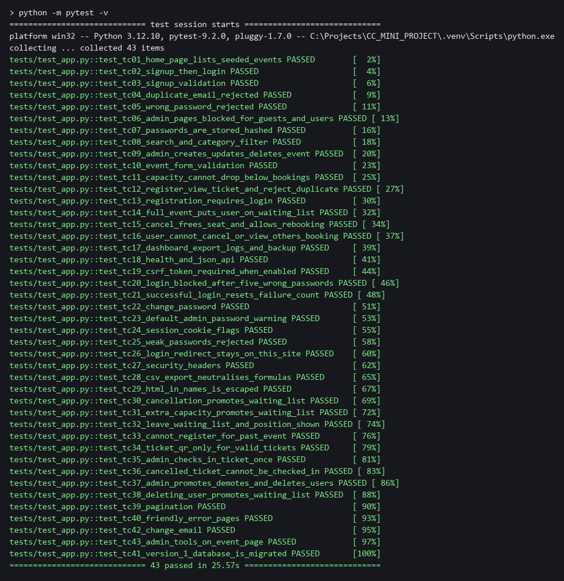

*Figure 20. Test run output – 43 passed (rendered from the saved pytest output)*

## 10. Deployment

The application is deployed on Render, a Platform-as-a-Service cloud, on the free plan. The source code is kept in a GitHub repository, and Render builds and starts the service from the render.yaml blueprint. Every push to the main branch triggers an automatic redeploy (continuous deployment). The live site was checked from outside: HTTPS is enforced, the health check reports the database as up, the security headers are present and the session cookie is marked Secure.

- Local: python app.py, then open http://localhost:5000.
- Container: docker build -t cloudevents . then docker run -p 8000:8000 -v cloudevents-data:/data cloudevents. (The image could not be built on the development machine because Docker is not installed.)
- Render (free plan): the GitHub repository is connected through New > Blueprint; render.yaml sets the start command, health check, generated secret key, secure-cookie, proxy and time-zone settings.
- On Render's free plan the disk is temporary, so data added after deployment is reset when the service restarts; the sample data is re-created each time. The free service also sleeps after about 15 minutes without visitors, so the first request afterwards takes up to a minute.

**Live URL:** https://cloudevents.onrender.com

**Source code:** https://github.com/Rupa-2006/cloudevents

## 11. Demonstration Script (about 6 minutes)

1. Open the home page as a guest; search, filter and move between pages.
2. Sign up as a new user, log in, register for an event and show the QR e-ticket.
3. Try to register again (duplicate message). Join the waiting list of the full cricket event and show the position.
4. As another user, cancel a cricket seat; show that the waiting user is now confirmed.
5. Log in as admin; show the dashboard, create and edit an event, show a validation error.
6. Open an event's attendee list, check a ticket in, try to check it in again, export the CSV.
7. Show user management, the activity log filter and the database backup.
8. Open /health and /api/events.
9. Security: enter a wrong password five times to trigger the lockout; open /admin as a normal user to show the 403 page.
10. Run python -m pytest -v to show 43 passing tests.

## 12. Limitations and Future Work

- The free hosting plan has no permanent disk and sleeps when idle (see section 10); a paid plan or a managed database would remove both limits.
- SQLite limits the service to one server; a managed PostgreSQL database would allow several.
- No email or SMS is sent for confirmations, waiting-list promotions or password resets.
- Possible extensions: event posters in object storage, paid tickets, attendance certificates, two-factor login for admins.

## 13. Conclusion

The system delivers the complete event life-cycle – publish, register, wait-list, ticket, check in and monitor – as a cloud-ready web service. It demonstrates authentication and access control, persistent storage, health monitoring, audit logging, backup, a REST API and container packaging, and it is defended against the common web attacks listed in section 6, with 43 automated tests as evidence.

